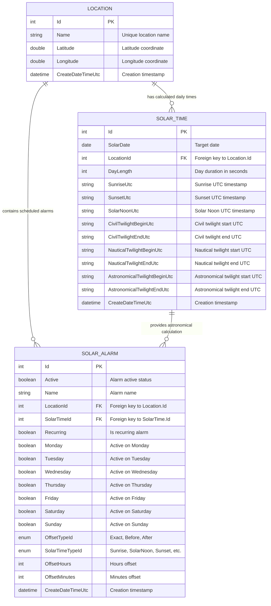

# Database Entity-Relationship Diagram (ERD)

This document describes the database schema and relationships for the Solar Alarm application (`SolarAlarmDatabase`).

## Entity-Relationship Diagram

## Schema Details

### Tables & Relationships

1. **`LOCATION`**
   - Stores saved user locations (latitude/longitude coordinates).
   - Has a one-to-many relationship with `SOLAR_TIME` (each location can have multiple calculated daily solar events).
   - Has a one-to-many relationship with `SOLAR_ALARM` (multiple alarms can be tied to a location).

2. **`SOLAR_TIME`**
   - Caches calculated solar/astronomical event times (sunrise, solar noon, sunset, twilights) for a specific location and date.
   - Referenced by `SOLAR_ALARM` to calculate precise trigger times.

3. **`SOLAR_ALARM`**
   - Defines scheduled solar alarms, including recurrence flags, solar event target (`SolarTimeTypeId`), and time offsets (`OffsetTypeId`, `OffsetHours`, `OffsetMinutes`).
